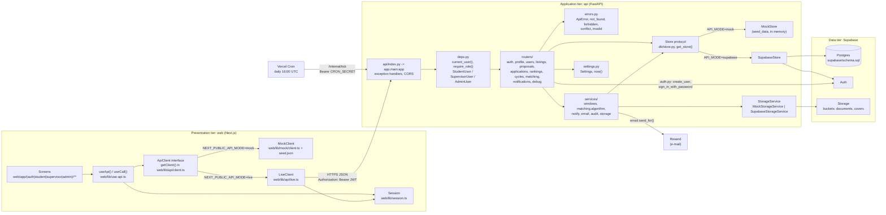
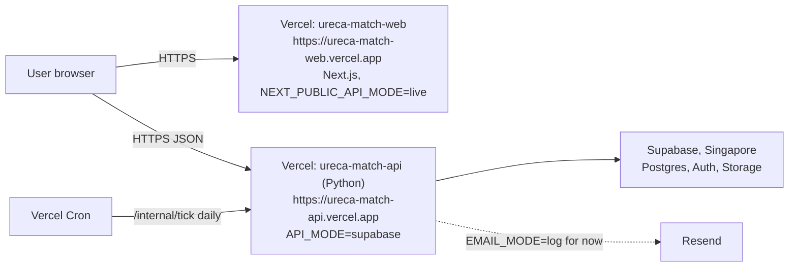

# System Architecture

URECAMatch, SC2006 Lab 3, SCEF Group 4. All paths are relative to `ureca-match-app/`.

## 1. Architectural style

URECAMatch is a three-tier, layered client-server system. Each tier talks only to the tier directly below it, and each tier maps to one of the Boundary, Control and Entity stereotypes used in our analysis models.

| Tier | Stereotype | Technology | Where in the repo | Main elements |
|---|---|---|---|---|
| Presentation | Boundary | Next.js 16, React 19, Tailwind v4 | `web/app/**` (route groups `(auth)`, `(student)`, `(supervisor)`, `(admin)`, `notifications`), `web/components/**`, `web/lib/` | screens such as `web/app/(student)/browse/page.tsx` and `web/app/(admin)/rounds/page.tsx`; `ApiClient`, `useApi()`, `useCall()`, `getSession()` |
| Application | Control | FastAPI, Python 3.12 | `api/app/main.py`, `api/app/deps.py`, `api/app/errors.py`, `api/app/routers/**`, `api/app/services/**` | `current_user()`, `require_role()`, router handlers such as `apply()` and `publish()`, `windows.phase()`, `notify()`, `audit()`, `match()` |
| Data | Entity | Supabase (Postgres, Auth, Storage) | `api/app/models/__init__.py`, `api/app/db/store.py`, `supabase/schema.sql` | `User`, `Listing`, `Application`, `Match`, `AuditEntry`; `Store`, `MockStore`, `SupabaseStore`; tables such as `listing_applications` and `audit_log` |

The browser never talks to Supabase directly. The web app has no Supabase client; every read and write goes through the API, which holds the service-role key. This keeps every rule in one place: the API routers enforce the SRS section 4 rules, and the UI only reflects them (see `api/app/main.py`, whose description states this).

We chose this style for three reasons.

- **Testability.** All business rules live in the API, so they can be tested without a browser or a database. `api/tests/conftest.py` resets the in-memory store before each test (`fresh_store`) and calls the API through FastAPI's test client as a chosen demo user (`client_for`, `as_student`, `as_admin`). The matching algorithm in `api/app/services/matching/algorithm.py` is a pure function with no I/O, so `api/tests/test_REQ_EXEC_algorithm.py` tests it with small fixtures.
- **Swappable data layer.** Services and routers depend on the `Store` protocol, not on Supabase. `MockStore` holds the seed in memory; `SupabaseStore` reads and writes Postgres. `get_store()` picks one from `API_MODE`. The web tier mirrors this: `getClient()` returns a `MockClient` (seeded from `web/lib/mock/seed.json`, no server needed) or a `LiveClient` (HTTP to the API) from `NEXT_PUBLIC_API_MODE`.
- **Parallel work by vertical slices.** The team split the system into five slices, each owning its routers, its `Store` methods, its screens and its tests. The shared contract `shared/openapi.json` is the agreement between web and API, so slices can build both ends at once.

| Slice | Scope | API routers |
|---|---|---|
| A | Accounts, profiles, user management | `auth.py`, `profile.py`, `users.py` |
| B | Project listings, self-proposed projects | `listings.py`, `proposals.py` |
| C | Applications, preference and applicant rankings | `applications.py`, `rankings.py` |
| D | Cycles, rounds, matching, offers | `cycles.py`, `matching.py`, `services/windows.py`, `services/matching/` |
| E | Notifications, dashboards, e-mail, audit, platform | `notifications.py`, `services/notify.py`, `services/email.py`, `services/audit.py` |

## 2. Component diagram

## 3. Request lifecycle

The steps below follow one live request: a student submits an application (`POST /applications`, REQ-APPLY-1, REQ-APPLY-2) with `NEXT_PUBLIC_API_MODE=live` and `API_MODE=supabase`.

1. **Screen.** On `web/app/(student)/apply/[id]/page.tsx` the student writes a statement, picks documents and presses submit. The page calls `call((api) => api.apply({...}))`, where `call` comes from `useCall()` in `web/lib/use-api.ts`.
2. **Client.** `getClient()` returns the `LiveClient`. Its private `req()` reads the session from `localStorage` (`getSession()`), adds `Authorization: Bearer <token>`, and sends JSON to `NEXT_PUBLIC_API_URL + "/applications"`.
3. **Entry point.** On Vercel, `api/vercel.json` rewrites every path to `/api/index`, and `api/api/index.py` exposes `app` from `app/main.py`. CORS allows `localhost:3000` and `*.vercel.app` origins.
4. **Input validation.** FastAPI parses the body into `ApplicationCreate`. A malformed body is caught by the `validation_error` handler in `main.py` and returned as `422 {code: "invalid", message, field}`.
5. **Dependencies.** FastAPI resolves `SettingsDep` (`get_settings()`, cached), `StoreDep` (`get_store()`, here a `SupabaseStore`) and `StudentUser`.
6. **JWT verification.** `current_user()` in `deps.py` decodes the bearer token with PyJWT (HS256, `SUPABASE_JWT_SECRET`, audience `authenticated`). An expired or tampered token gives `401 session_expired`. The user row is loaded by the `sub` claim (or by e-mail), and a non-active account gives `403 account_inactive` (REQ-AUTH-2).
7. **Role guard.** `StudentUser` wraps `require_role(Role.student)`. A supervisor or admin token gets `403 forbidden` before the handler runs (NFR 5.3.2).
8. **Window check.** `apply()` in `routers/applications.py` first calls `_require_window()`, which asks `windows.in_application_window(store.cycle, settings.now())`. Outside an Application Window this raises `invalid("window_closed", ...)`, a 422.
9. **Business rules.** The handler checks, in order: the listing exists and is published (`not_found`), the profile is complete and the student is still eligible (`conflict`), a slot is free (`conflict`), every attached document is the student's own (`invalid`, object-level rule), and the student has not already applied (`conflict`). Each helper in `errors.py` builds an `ApiError`; the `api_error` handler in `main.py` returns its `{code, message, field}` body with the right status (SRS 5.4.2 plain-language errors).
10. **Persist.** The handler builds an `Application` with `preference_rank = len(active) + 1` and `round_id` from `windows.phase()`, then calls `store.save_applications(app)`. `SupabaseStore.save_applications()` upserts the row into `listing_applications` before the response is sent (NFR 5.2).
11. **Response.** FastAPI serialises the `Application` (`response_model`) with status 201. `LiveClient` returns it typed; on any non-2xx it throws `ApiError` with the server's code and message, which the page shows. A 401 makes `handleAuthError()` clear the session and redirect to `/sign-in?reason=session_expired`. A successful call refreshes the browser session (`touchSession()`).

Submitting an application does not notify anyone or write to the audit log. Requests that do, such as publishing results (`POST /admin/rounds/{round_id}/publish`, guarded by `AdminUser`), add two steps after the state change:

12. **Audit.** `audit(store, admin, AuditOperation.results_published, [round_id], now)` in `services/audit.py` appends an `AuditEntry` with the actor and time (REQ-AUDIT-1).
13. **Notify.** `notify(store, user_ids, NotificationEvent.offer_received, title, message, now, link)` in `services/notify.py` builds one `Notification` per recipient, stores them with `store.save_notifications()`, then calls `email.send_for()`, which sends them through Resend according to `EMAIL_MODE` (REQ-PUB-2, NFR 5.1.2). No other code inserts notifications or audit rows.

## 4. Design patterns

| Pattern | Where | Why |
|---|---|---|
| Repository | `Store` protocol in `api/app/db/store.py`, implemented by `MockStore` and `SupabaseStore` | Routers and services work with domain objects (`Listing`, `Application`) and never with SQL or the Supabase SDK. The data source can change without touching rules. |
| Strategy, selected by configuration | `get_store()` (`API_MODE`), `get_storage()` (`API_MODE`), `getClient()` (`NEXT_PUBLIC_API_MODE`), `email.send_for()` (`EMAIL_MODE`: off, log, send) | One switch per environment picks the implementation at run time. Developers run everything offline; production uses real services with no code change. |
| Facade | `ApiClient` interface in `web/lib/api/client.ts` | Screens call one method per use case (`apply()`, `publish()`) and never deal with URLs, headers, tokens or error parsing, which `LiveClient.req()` hides. |
| Adapter | `SupabaseStorageService` (adapts the Supabase Storage SDK to `put()` and `signed_url()`); `email.send_for()` and `render()` (adapt a `Notification` to a Resend batch message); `LiveClient.req()` (adapts the HTTP error envelope to the web `ApiError` class) | External services keep their own interfaces; the rest of the code depends only on ours. |
| Dependency injection | FastAPI `Depends` in `deps.py`: `SettingsDep`, `StoreDep`, `CurrentUser`, `StudentUser`, `SupervisorUser`, `AdminUser` | Handlers declare what they need. Auth and role checks become reusable, and tests swap the store via `reset_store()` and monkeypatching. |
| Lazy singleton | `_store` in `db/store.py`, `_storage` in `services/storage.py`, `get_settings()` (`lru_cache`), `_client` in `web/lib/api/client.ts` | One instance per process, created on first use, so start-up stays cheap. |
| Single source of truth | `services/windows.py` (`phase()`, `in_application_window()`, `in_review_window()`); `Settings.now()` | Every guard, and the UI via `GET /me`, asks the same function what phase the cycle is in, so date logic cannot drift between screens and API. Every deadline reads one clock. |
| Generated contract (code-first) | Pydantic models in `api/app/models/__init__.py` -> `app.db.export` writes `shared/openapi.json` -> `npm run gen` (openapi-typescript) writes `web/lib/api/types.ts` -> aliases in `web/lib/api/models.ts` | Web types cannot drift from the API. CI regenerates both files and fails if either differs from the committed copy. |
| Functional core | `match()` in `services/matching/algorithm.py` (student-proposing deferred acceptance with capacities) | No database, clock or I/O inside the algorithm, so it is deterministic and unit-testable; `execute()` in `routers/matching.py` does the I/O around it. |

## 5. Key design issues

### 5.1 Persistent data management

- **Tables.** `supabase/schema.sql` defines the entity classes of the SRS class diagram as tables: `users`, `student_profiles`, `supervisor_profiles`, `verification_codes`, `supporting_documents`, `application_cycles`, `matching_rounds`, `project_listings`, `listing_applications`, `applicant_rankings`, `self_proposed_applications`, `match_results`, `notifications` and `audit_log`. Status fields are Postgres enums matching the Python enums (`role`, `match_status`, `audit_operation` and so on). A unique index `preference_rank_unique` enforces one rank per student per round (REQ-SRANK-2); `SupabaseStore.save_applications()` clears ranks before re-writing them so a swap does not clash halfway.
- **Storage buckets.** `documents` (private; student supporting documents) and `covers` (public; listing images). Uploads go through `StorageService.put()`. Documents are only ever read through `GET /documents/{document_id}/view`, which returns a 10-minute signed URL from `signed_url()`.
- **Append-only audit log.** The trigger `audit_log_no_update` runs `audit_log_immutable()` before any `UPDATE` or `DELETE` on `audit_log` and raises an exception, so not even the service role can change history (REQ-AUDIT-2). In the API, `audit()` is the only writer and `GET /admin/audit` is read-only.
- **Seed generation.** Demo data is written once in Python (`api/app/db/seed_data.py`). `uv run python -m app.db.export` turns it into `web/lib/mock/seed.json` (web mock mode) and `supabase/seed.sql` (real database), so both modes show the same data. `app.db.seed_auth` creates the matching Supabase Auth accounts.
- **Current coverage.** `SupabaseStore` overrides the `MockStore` methods for users, profiles, documents, listings, proposals, applications, applicant rankings and notifications. Cycles, rounds, matches and audit entries are still served from the in-memory seed inherited from `MockStore`, even with `API_MODE=supabase` (see section 8).

### 5.2 Access control and security

- **Authentication.** In Supabase mode, `POST /auth/register` creates the account in Supabase Auth (`auth.admin.create_user`) and `POST /auth/sign-in` checks the password with `sign_in_with_password`, so the API never stores passwords. Sign-in then issues an HS256 JWT signed with the project's JWT secret (`sub`, `email`, `role`, `aud: authenticated`, `exp`). Registration is restricted to `APPROVED_EMAIL_DOMAINS` (REQ-REG-1).
- **30-minute sessions.** `SESSION_MINUTES=30` sets the token's `exp`. `current_user()` rejects an expired token with `401 session_expired`. In the browser, `web/lib/session.ts` drops the stored session after 30 minutes without an API call, and `touchSession()` extends it after each successful call.
- **Role guards.** Every non-public endpoint depends on `StudentUser`, `SupervisorUser` or `AdminUser` (`require_role()`), or at least `CurrentUser`. Guards live in the routers, never only in the UI.
- **Generated role-matrix test.** `api/tests/test_NFR_5_3_roles.py` reads every path and method from `shared/openapi.json` and calls each restricted endpoint as each wrong role, expecting 403 (`test_NFR_5_3_2_role_matrix`). `test_NFR_5_3_2_every_endpoint_classified` fails when someone adds an endpoint without classifying it, so new endpoints cannot skip the check.
- **Object-level rules.** Beyond roles, handlers check ownership: a student may only attach their own documents (`apply()`); a supervisor may only decide their own matches (`_decide()`), edit their own listings and see their own proposals; documents are visible only to the owner, admins, or a supervisor the student applied to (`_may_view()` in `rankings.py`); notifications are marked read only by their owner. Tests include `test_REQ_APPRV_supervisor_cannot_decide_another_supervisors_match`, `test_REQ_PROJ_2_cannot_edit_another_supervisors_listing`, `test_REQ_VRANK_3_other_student_cannot_view` and `test_REQ_NOTIF_2_supabase_mark_read_scoped_to_owner`.
- **Secrets stay server-side.** `SUPABASE_SERVICE_ROLE_KEY`, `SUPABASE_JWT_SECRET`, `CRON_SECRET` and `RESEND_API_KEY` are read only by `Settings` in the API. The web build only sees `NEXT_PUBLIC_API_MODE`, `NEXT_PUBLIC_API_URL` and `NEXT_PUBLIC_DEBUG_CLOCK`. Row-level security is enabled on every public table with no policies, so the anon key reads nothing.
- **Cron endpoint.** `POST /internal/tick` has no user; outside mock mode it requires `Authorization: Bearer <CRON_SECRET>`.

### 5.3 Global control flow

The system is event-driven at the tier boundary and procedure-driven inside each request. Every user action is one synchronous HTTP request and response; there are no background workers, queues or threads. Long steps also run inside a request: the matching run is executed inside `POST /admin/rounds/{round_id}/execute`, and e-mails are handed to Resend inside the request that created the notification.

Time-based changes are driven by a daily timer. `api/vercel.json` registers a Vercel Cron job for `/internal/tick` at `0 16 * * *` (16:00 UTC, midnight in Singapore). `tick()` in `routers/matching.py` moves round statuses into their application or review window and times out unanswered offers (REQ-OUTCOME-3, REQ-OUTCOME-4). The admin Matching Rounds screen (`web/app/(admin)/rounds/page.tsx`) also calls `tick()` when it opens. Most window logic does not depend on the cron at all, because guards compute the phase from dates on every request through `windows.phase()`.

### 5.4 Boundary conditions

- **Start-up and entry point.** Locally: `uv run fastapi dev app/main.py` and `npm run dev`. On Vercel: `api/api/index.py` imports `app.main.app`. `main.py` registers the routers and the two exception handlers. The store, storage service and web client are created lazily on the first request, not at import time.
- **Mode selection.** `API_MODE` (mock or supabase) chooses the store and storage service. `NEXT_PUBLIC_API_MODE` (mock or live) chooses the web client; in web mock mode no API is needed at all. `EMAIL_MODE` (off, log or send) chooses e-mail behaviour. `DEBUG_CLOCK` enables the `/debug/clock` routes; when it is off they answer 404, so production cannot be time-travelled.
- **The clock.** `Settings.now()` is the only source of "now". In mock mode it returns the fixed demo time (7 Sep 2026, 10:00 UTC, inside Round 2's Application Window), making demos and tests deterministic. In Supabase mode it returns the real UTC time, unless `DEBUG_CLOCK=true` and an override was set through `PUT /debug/clock`.
- **E-mail failure.** `notify()` saves notifications first, then calls `email.send_for()`. If `EMAIL_MODE=send` but `RESEND_API_KEY` is empty, it logs an error and sends nothing. If a Resend batch call raises, the exception is caught and logged per batch of up to 100 e-mails, and the request still succeeds. The in-app notification already stands, so the user still sees it (`test_NFR_5_1_2_failed_send_keeps_notification`). There is no retry.
- **Errors.** Every expected failure is an `ApiError` with `{code, message, field}`, and validation errors use the same shape. The web client turns these into `ApiError` objects; a 401 returns the user to sign-in.
- **Restart.** The API is stateless between requests apart from the in-memory parts noted in 5.1, which return to the seed when a process restarts. The debug clock override is also per process.

## 6. Deployment

| Part | Platform | Configuration |
|---|---|---|
| Web | Vercel project `ureca-match-web`, https://ureca-match-web.vercel.app | Framework preset Next.js; `NEXT_PUBLIC_API_MODE=live`; `NEXT_PUBLIC_API_URL` points at the API. |
| API | Vercel project `ureca-match-api` (Python), https://ureca-match-api.vercel.app | `api/vercel.json` routes all paths to `api/index.py` and defines the cron. `API_MODE=supabase`. Supabase keys and `CRON_SECRET` are stored as Vercel secrets. |
| Data | Supabase, Singapore region | Schema from `supabase/schema.sql`, demo rows from `supabase/seed.sql`, auth users from `app.db.seed_auth`. |
| E-mail | Resend | `EMAIL_MODE=log` for now: e-mails are logged, not sent, until a sender domain is verified. |

Both projects are deployed with the Vercel CLI. The repository belongs to the course's GitHub organisation, and Vercel's free plan cannot deploy private organisation repositories through its Git integration. A GitHub Actions workflow that runs the Vercel CLI is planned, to restore automatic deploys from `main` and preview deploys per pull request; it is not in place yet.

Continuous integration runs on every pull request and every push to `main` (`.github/workflows/ci.yml` at the repository root). The `api` job runs `ruff check`, `pytest`, and a contract check (`app.db.export`, then `git diff --exit-code` on `shared/openapi.json`). The `web` job runs `npm run gen` with a diff check on `lib/api/types.ts`, then `eslint` (`npm run lint`), `tsc --noEmit` (`npm run typecheck`) and `next build` (`npm run build`).

## 7. Traceability to non-functional requirements

| SRS NFR | Requirement (short) | How the architecture meets it | Evidence | Status |
|---|---|---|---|---|
| 5.1.2 | In-app notification within 1 minute; e-mail within 15 minutes | `notify()` stores the notification and calls `email.send_for()` in the same request, so both happen at once rather than on a schedule. One template per event in `TEMPLATES`. | `test_NFR_5_1_2_email_dispatched_on_notify`, `test_NFR_5_1_2_no_send_unless_mode_is_send`, `test_NFR_5_1_2_failed_send_keeps_notification`, `test_NFR_5_1_2_every_event_has_a_template` | In-app: met. E-mail: path built, production on `EMAIL_MODE=log` until a domain is verified. |
| 5.1.4 | Matching completes within 10 minutes of the Review Window closing; read-only access stays available | `match()` is an in-memory, I/O-free algorithm run inside one request. Each request is independent, so other users can keep reading during a run. | `test_REQ_EXEC_algorithm.py`, `test_REQ_EXEC_flow.py` | Design supports it; execution time not yet measured. Matching is started by an admin, not automatically at window close. |
| 5.2 | Rankings committed on submission; recover within 5 minutes; daily backups | `save_applications()` and `save_ranking()` write to Postgres before the response is returned. The API holds no session state, so a new serverless instance serves the next request. | `SupabaseStore` in `db/store.py` | Partly met: cycles, matches and audit are not yet persisted in Supabase mode. Backups rely on Supabase and are not configured in the repo. |
| 5.3.1 | NTU domains only; 30-minute session; hashed passwords | Domain check in `register()`; token `exp` from `SESSION_MINUTES`; passwords handled by Supabase Auth, never stored by the API. | `test_REQ_REG_1_non_ntu_email_rejected`, `test_REQ_AUTH_2_inactive_account_cannot_act`; no test yet for token expiry | Met, except that the server token expires 30 minutes after sign-in rather than after 30 minutes of inactivity. |
| 5.3.2 | Every request authorised by role | `require_role()` dependencies on every restricted endpoint; object-level ownership checks in handlers. | `test_NFR_5_3_2_role_matrix`, `test_NFR_5_3_2_every_endpoint_classified` | Met. |
| 5.3.4 | Audit log append-only; reassignments attributable | `audit()` is the only writer and records `actor_id`, `actor_name` and `timestamp`; `reassign()` and `manual_assign()` call it with the justification. Database trigger `audit_log_no_update` blocks updates and deletes. | `test_REQ_OUTCOME_AUDIT_REV.py`, `supabase/schema.sql` | API rules met. Entries are not yet written to the `audit_log` table in Supabase mode. |
| 5.4.3 | Reusable across cycles; dates changeable at run time without redeploy | Cycles and rounds are data, edited through `/admin/cycles` endpoints (`create_cycle()`, `update_cycle()`, `set_rounds()`). Every guard reads dates through `windows.phase()`. Environment settings live in `Settings`. | `test_REQ_CYCLE_and_ROUND.py` | Met in the API; cycle changes are not yet persisted in Supabase mode. |
| 5.4.4 | Code documentation, API specification, setup guide | Module docstrings tagged with REQ-IDs; OpenAPI at `/docs` and in `shared/openapi.json`; `docs/SETUP.md`, `docs/CONTRIBUTING.md`, `docs/traceability.md` and this document. | CI contract check | Met. |

## 8. Open items

- `SupabaseStore` does not yet persist cycles, rounds, matches, audit entries or verification codes. In Supabase mode these live in process memory and return to the seed when an instance restarts.
- The Vercel Cron job targets `/internal/tick`, but `tick()` only accepts `POST`. Vercel Cron calls a path with `GET`, so the daily job needs checking.
- `web/app/(admin)/rounds/page.tsx` calls `tick()` with the admin's token. In Supabase mode the endpoint expects `CRON_SECRET`, so it answers 401, and the web client treats any 401 as an expired session.
- `supabase/schema.sql` refers to a `policies.sql` for storage policies, which is not in the repo.
- The planned GitHub Actions deploy workflow does not exist yet.
